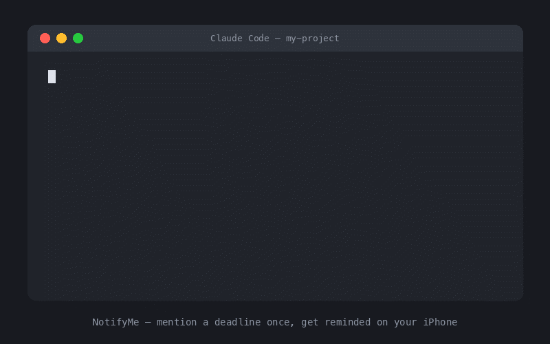

# Cuebird

[](https://github.com/mtvchk/cuebird/releases)
[](LICENSE)
[](#requirements)
[](https://github.com/anthropics/claude-code)

**Mention a deadline once. Get reminded on your iPhone, guaranteed.**



Cuebird makes Claude Code deadline-aware in every project. When a concrete
deadline surfaces in conversation — yours, or a checkpoint Claude itself plans
— Claude offers once to set a reminder. Say yes, and it lands in Apple
Reminders, syncs to your iPhone over iCloud within seconds, and fires locally on
the phone at the right moment — whether your Mac is on, Claude Code is running,
or this plugin is even still installed.

## Why Cuebird

- **Survives the session:** reminders fire on your Apple devices even when the
  Mac is off and Claude Code is closed.
- **Verified delivery path:** Cuebird reads every new reminder back before
  reporting success.
- **Context comes back:** mention `нагадування: <key>` later and Claude can
  restore the saved project context and next steps.
- **Consent first:** it offers once and creates a reminder only after you agree.
- **Local by design:** no account, token, configuration file, telemetry, or
  hosted service.

## Requirements

- macOS with the Reminders app signed into iCloud
- An iPhone, iPad, or Apple Watch on that same iCloud account
- Claude Code with plugin and hook support

First use is the setup. There is no account to create, token to copy, or
configuration file to edit.

## Install

```text
/plugin marketplace add mtvchk/cuebird
/plugin install cuebird@cuebird
```

The first time you accept a reminder, macOS asks once for permission to access
Reminders. No further configuration is required.

Each project gets its own Reminders list, named the way Claude Code names the
project (worktrees count as their main project). Want them tidy? Put them in a
list group by hand (Reminders → File → New Group); Cuebird keeps finding them.

## How it works

1. The session hook tells Claude to notice actionable future checkpoints.
2. Claude offers one meaningful reminder when a deadline surfaces.
3. You accept it or adjust the date in the same reply.
4. Cuebird creates the reminder in the project's list via EventKit and reads it
   back to confirm it exists.
5. iCloud syncs the reminder to your other Apple devices, typically within
   seconds.
6. Your iPhone shows the notification locally, even if your Mac is off.
7. Later, mention `нагадування: <key>` in any session to restore the saved work
   context.

## Commands

- `cuebird:remind` — create a reminder explicitly, such as "remind me August
  3rd about the release."
- `cuebird:reminders` — review and manage active, declined, deferred, and
  completed decisions; every state is reversible.
- `cuebird:resume` — restore the work context for a fired reminder.
- `cuebird:doctor` — run seven end-to-end diagnostics, including an on-demand
  update check.

## Privacy

- No telemetry, analytics, or automatic network calls.
- Reminder content lives in Apple Reminders under Apple's iCloud rules and in a
  local journal under `~/.claude/cuebird/`.
- The only network call is `cuebird:doctor`'s explicit update check against the
  public GitHub Releases API.

## Troubleshooting

Run `cuebird:doctor` first. It checks seven things end to end and names the
specific fix when something is wrong.

- **"macOS denied access to Reminders."** Go to **System Settings → Privacy &
  Security → Reminders**, enable it for your terminal or Claude, then retry.
- **"Reminders will only be created on this Mac."** Go to **System Settings →
  Apple ID → iCloud** and enable Reminders.

## Scope

| Claude Code on | Device | Support |
| --- | --- | --- |
| macOS | iPhone / iPad / Watch | Apple Reminders (this release) |
| macOS | Android | Planned — ntfy adapter |
| Windows / Linux | Any | Planned — ntfy adapter |

## License

[MIT](LICENSE) © 2026 mtvchk
